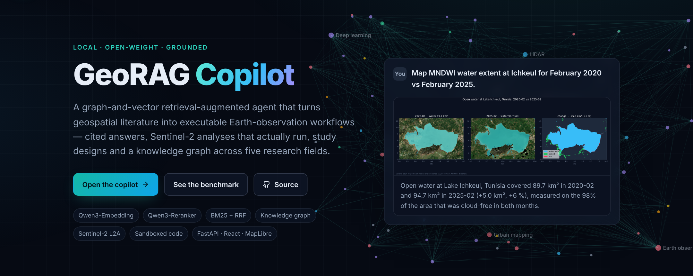
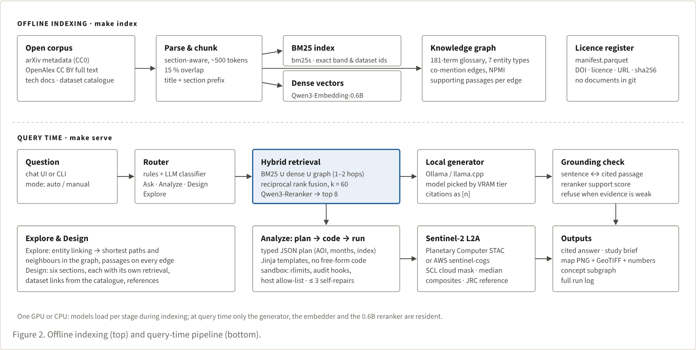

<div align="center">



# GeoRAG Copilot

**A local graph-and-vector retrieval-augmented agent that turns geospatial literature into executable Earth-observation workflows.**

Cited answers · Sentinel-2 analyses that actually run · study designs · a knowledge graph across GIS, remote sensing, LiDAR, digital twins and geospatial computer vision — on one machine, with open-weight models.

[**Live showcase**](https://emna-saada.github.io/GeoRAG/) · [Benchmark report](results/REPORT.md) · [Design notes](docs/design-notes.md)

[](https://github.com/emna-saada/GeoRAG/actions/workflows/ci.yml)


</div>

<!-- DEMO -->

## Why

LLM agents for GIS are an active research front — LLM-Geo, GIS Copilot inside QGIS, benchmarks such as
GeoAnalystBench — and industry runs cloud versions such as Microsoft and NASA's Earth Copilot. GeoRAG
Copilot is the **open, local and private** counterpart: every model is open-weight and runs on a single
consumer GPU or, more slowly, on a CPU; every answer is grounded in openly licensed sources; every
analysis is code you can read and rerun.

## What it does

| Mode | Example request | What it generates |
|---|---|---|
| **Ask** — cited answers | *How does MNDWI differ from NDWI for mapping open water, and when is each preferred?* | A concise answer with numbered citations to the exact passages; each sentence is checked against its source by a cross-encoder and flagged if unsupported; related concepts from the graph |
| **Analyze** — code that runs | *Map MNDWI water extent at Ichkeul for February 2020 vs February 2025.* | A typed plan → a Python script from audited templates → a sandboxed run on Sentinel-2 L2A → map layers, GeoTIFFs, areas, the code and every repair attempt |
| **Design** — study briefs | *Design a study on rooftop solar potential from airborne LiDAR in a Mediterranean city.* | A six-section brief (question, area, data with access links, method, validation, risks), each section with its own retrieval and references |
| **Explore** — knowledge graph | *How are foundation models and wetlands connected in the corpus?* | An interactive subgraph of methods, sensors, datasets and applications, the concept paths between them and the passages behind every edge |

**Guardrails.** The agent refuses when retrieval finds nothing relevant. Citation numbers can only point
at retrieved passages. Analyze mode never writes free-form code: the model fills a typed plan, geography
and dates come from the gazetteer or the request, and the script runs with a static check, CPU, memory
and file-size limits, PEP 578 audit hooks and a host allow-list.

<!-- RESULTS -->

## Architecture



**Indexing (`make index`)** — open corpus → section-aware chunks (~500 tokens, 15 % overlap, title and
section prefixed) → BM25 (`bm25s`) + dense vectors (Qwen3-Embedding-0.6B) + a knowledge graph anchored on
a 181-term glossary (methods, sensors, datasets, products, applications, places, standards), with
NPMI-weighted co-mention edges that keep their supporting passages. Every stage is fingerprinted and
idempotent; wall times go to `results/compute_log.jsonl`.

**Query time (`make serve`)** — router → BM25 ∪ dense ∪ graph (1–2 hops) → reciprocal rank fusion →
Qwen3-Reranker → top 8 → local generator → sentence-level support check. Analyze mode adds plan → template
→ sandbox → up to three self-repairs, against the Planetary Computer STAC API or the public AWS
`sentinel-cogs` archive.

| Component | Choice | Why |
|---|---|---|
| Generator | Picked by detected VRAM: `qwen3:4b` (CPU) · `qwen3:8b` (8 GB) · `gpt-oss:20b` (12–16 GB) · `qwen3.8:27b` (24 GB) | Open weights, strong at code and reasoning; served by Ollama or llama.cpp through one OpenAI-compatible client |
| Embeddings | Qwen3-Embedding-0.6B (4B from 16 GB) | Apache-2.0, instruction-aware, top of MTEB multilingual at release |
| Reranker | Qwen3-Reranker-0.6B | Cross-encoder P(yes); reused as the faithfulness judge |
| Sparse | BM25 (`bm25s`, Snowball stemmer, identifiers kept whole) | Band names, EPSG codes and dataset ids are exact tokens |
| Vector store | Exact float16 matrix | Milliseconds at this scale, trivial metadata filters; swap for Qdrant/LanceDB past ~10⁵ chunks |
| Graph | NetworkX + Parquet | Transparent and testable |
| Orchestration | Plain Python + Pydantic | Every step is an explicit function call, logged and unit-tested |

Design rationale and trade-offs: [docs/design-notes.md](docs/design-notes.md).

## Quick start

```bash
git clone https://github.com/emna-saada/GeoRAG && cd GeoRAG
make setup    # uv environment, web dependencies, writes configs/hardware.yaml for your GPU
make models   # pulls the tier's generator into Ollama   (no GPU/Ollama: `make llm` serves a GGUF with llama.cpp)
make index    # corpus → chunks → BM25 → vectors → knowledge graph
make serve    # API + web app on http://127.0.0.1:8000
```

```bash
make eval     # GeoRAG-Bench → results/ and results/REPORT.md
make demos    # record the showcase runs
make site     # export site data and build the static showcase
make test     # unit + integration tests (fixture corpus, scripted LLM — no GPU, no network)
```

Or from the command line:

```bash
uv run georag ask "What is Prithvi pre-trained on?"
uv run georag analyze "Compute NDVI around Bizerte for July 2024."
uv run georag explore "How are LiDAR and digital twins connected?"
uv run georag design "Design a study on flood mapping with Sentinel-1 in Tunis."
```

### Hardware tiers

`georag hardware` reads `nvidia-smi` and writes `configs/hardware.yaml`; nothing is chosen by hand.

| Detected | Generator | Embedding / reranker | Rerank depth |
|---|---|---|---|
| CPU only | `qwen3:4b` (Qwen3-4B-Instruct-2507, Q4_K_M via llama.cpp) | 0.6B / 0.6B, bfloat16 on AMX/AVX-512 CPUs | 20 |
| 8 GB | `qwen3:8b` | 0.6B / 0.6B | 30 |
| 12–16 GB | `gpt-oss:20b` (fallback `qwen3.5:9b`) | 4B / 0.6B | 30 |
| 24 GB | `qwen3.8:27b` | 4B / 0.6B | 30 |

`make models` verifies each tag with `ollama pull` and falls back down the list if a tag is missing.

## Corpus and licences

Only openly licensed material is indexed, and **the repository never contains the documents** — only the
scripts, the domain rules and the licence register ([`corpus/manifest.parquet`](corpus/manifest.parquet):
identifier, title, authors, year, licence, URL and SHA-256 of the indexed text for every document).

| Source | What | Licence |
|---|---|---|
| arXiv metadata snapshot (`librarian-bots/arxiv-metadata-snapshot`) | Titles and abstracts, 400 papers per domain, 2018–2026, selected by the rules in [`configs/domains.yaml`](configs/domains.yaml) | Metadata CC0; each paper's own licence recorded |
| OpenAlex (optional, `georag corpus --source openalex`) | Full text of CC BY / CC0 open-access papers, parsed with `pymupdf4llm` | CC BY / CC0 only |
| Technical documentation | STAC spec and API, PDAL, GDAL, rasterio, pystac-client, odc-stac, CityJSON, OGC 3D Tiles, TerraTorch, Planetary Computer | Each project's licence, per file |
| Dataset catalogue | Planetary Computer collections, or the AWS Registry of Open Data, plus JRC GSW, AHN and 3DBAG | Per dataset |
| Glossary | [`corpus/glossary.yaml`](corpus/glossary.yaml) — 181 terms with aliases and definitions | CC BY 4.0 |

Code: Apache-2.0. Sentinel-2 data: © Copernicus, processed. JRC Global Surface Water: © European Commission.

## Project layout

```
src/georag/
  corpus/       arXiv, OpenAlex, docs and catalogue collectors; manifest
  index/        chunking, BM25, dense, RRF, reranker, knowledge graph, stage runner
  agent/        router, Ask / Design / Explore, Analyze (plans, templates, repairs), grounding
  geo/          Sentinel-2 search (STAC or bucket), SCL masking, composites, outputs, gazetteer
  eval/         GeoRAG-Bench builder, metrics, runner, report
  sandbox.py    static check, rlimits, audit hooks
  server.py     FastAPI + Server-Sent Events
web/            React + Vite + MapLibre + Cytoscape + ECharts (live app and static showcase)
eval/bench/     benchmark questions and Analyze tasks
results/        every number shown in this README and on the site
```

## Related work

| Work | What it does | How GeoRAG Copilot differs |
|---|---|---|
| LLM-Geo / Autonomous GIS (Li & Ning, 2023) | GPT-4 decomposes spatial tasks and returns maps without human intervention | Local open models; logging, sandbox and tests built in; grounded in literature |
| GIS Copilot (Akinboyewa et al., 2024) | LLM agent inside QGIS; strong on basic tasks, complex ones remain hard | Retrieval over papers, docs and catalogues; runs on open STAC data outside QGIS |
| GeoAnalystBench, GeoBenchX | Benchmarks for LLM spatial-analysis code | GeoRAG-Bench adds citation faithfulness, cross-domain retrieval and reference-checked Analyze tasks |
| Earth Copilot (Microsoft & NASA) | Natural language → STAC queries on Azure | Fully local and open-weight; adds literature grounding, code execution and study design |
| LightRAG | Graph + vector RAG with local/global modes | Glossary-anchored graph suited to small local models; every edge keeps its evidence |

## Citation

```bibtex
@software{saada_georag_2026,
  author  = {Saada, Emna},
  title   = {GeoRAG Copilot: A Local Graph-and-Vector Retrieval-Augmented Agent that Turns Geospatial Literature into Executable Earth-Observation Workflows},
  year    = {2026},
  url     = {https://github.com/emna-saada/GeoRAG},
  license = {Apache-2.0}
}
```

<sub>Emna Saada · geospatial data science · [github.com/emna-saada](https://github.com/emna-saada)</sub>
