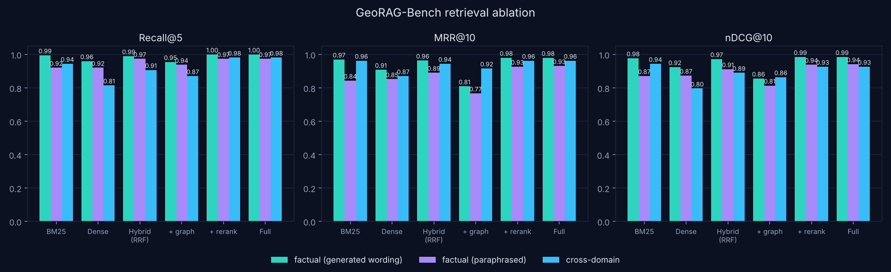
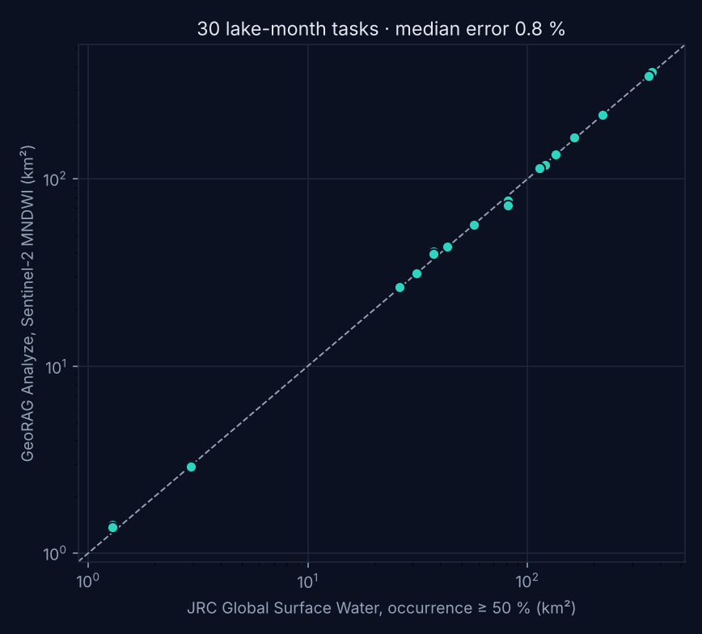

# GeoRAG Copilot — evaluation report

_Generated 2026-10-29 by `make eval`. All numbers in this file are produced by the code in `src/georag/eval/`._

## Setup

- **Hardware:** CPU only: Intel(R) Xeon(R) Processor @ 2.10GHz, 4 threads (tier `cpu`)
- **Generator:** `Qwen3-4B-Instruct-2507 (Q4_K_M, llama.cpp)`; small generator `Qwen3-1.7B (Q4_K_M, llama.cpp)`
- **Embedding:** `Qwen/Qwen3-Embedding-0.6B` · **Reranker:** `Qwen/Qwen3-Reranker-0.6B`
- **Corpus:** 2239 documents (arxiv: 2000, glossary: 181, docs: 37, catalogue: 21); knowledge graph with 181 concepts and 1903 links.
- **GeoRAG-Bench:** 200 factual, 27 cross-domain, 30 unanswerable, 30 analyze, 113 paraphrased.

## 1. Retrieval ablation

Gold = the passage a question was generated from (both passages for cross-domain questions). Hybrid = BM25 and dense lists fused with reciprocal rank fusion (k = 60); the graph list enters fusion with weight 0.6; the reranker reorders the fused top 20 (CPU tier; 30 on GPU tiers).

| Configuration | R@5 | R@10 | MRR@10 | nDCG@10 | Cross both@8 | Cross nDCG@10 |
|---|---:|---:|---:|---:|---:|---:|
| BM25 | 0.995 | 1.000 | 0.971 | 0.978 | 0.963 | 0.944 |
| Dense | 0.960 | 0.975 | 0.908 | 0.925 | 0.704 | 0.796 |
| Hybrid (RRF) | 0.990 | 1.000 | 0.964 | 0.973 | 0.889 | 0.890 |
| Hybrid + graph | 0.955 | 1.000 | 0.809 | 0.856 | 0.852 | 0.864 |
| Hybrid + rerank | 1.000 | 1.000 | 0.980 | 0.985 | 0.963 | 0.927 |
| Full: hybrid + graph + rerank | 1.000 | 1.000 | 0.980 | 0.985 | 1.000 | 0.927 |

95 % bootstrap interval for the full system's factual Recall@5: 1.000–1.000.

**Paraphrased questions.** The 113 factual questions were reworded by the generator to limit word overlap with the original question (and hence with the gold passage), keeping the same gold passages:

| Configuration | R@5 | R@10 | MRR@10 | nDCG@10 |
|---|---:|---:|---:|---:|
| BM25 | 0.920 | 0.956 | 0.844 | 0.871 |
| Dense | 0.920 | 0.938 | 0.852 | 0.874 |
| Hybrid (RRF) | 0.974 | 0.974 | 0.891 | 0.912 |
| Hybrid + graph | 0.938 | 0.956 | 0.767 | 0.814 |
| Hybrid + rerank | 0.974 | 0.974 | 0.927 | 0.939 |
| Full: hybrid + graph + rerank | 0.974 | 0.974 | 0.931 | 0.942 |

The figure-index stage (`+ figures`) is implemented for the PDF path but not evaluated: the abstract corpus contains no figures.

## 2. End-to-end answers (Ask mode, full retrieval)

| Set | n | Refused | Faithfulness | Citation precision | Gold cited | Answer recall | Token F1 | Median s |
|---|---:|---:|---:|---:|---:|---:|---:|---:|
| factual | 100 | 6.0 % | 96.2 % | 99.5 % | 98.9 % | 88.1 % | 0.270 | 52.785 |
| cross | 27 | 3.7 % | 58.5 % | 88.7 % | 100.0 % | 48.1 % | 0.451 | 96.24 |
| unanswerable | 30 | 100.0 % | — | — | — | — | — | — |
| factual (small generator) | 50 | 0.0 % | 51.7 % | 100.0 % | 94.0 % | 82.2 % | 0.100 | 46.16 |
| unanswerable (small generator) | 30 | 100.0 % | — | — | — | — | — | — |

*Faithfulness* is the share of answer sentences whose cited passage the reranker judges as supporting (P(yes) ≥ 0.25); *citation precision* is the same at the level of individual citations; *refused* on the unanswerable set is the correct-refusal rate, and on the answerable sets it is the false-refusal rate.

## 3. Analyze tasks

30 natural-language requests (one lake, one month each). Success rate **100.0 %** (100.0 % on the first attempt; mean 0.0 repairs). Water area against JRC GSW occurrence ≥ 50 %: median absolute error **0.82 %**, 93.3 % of tasks within 10 %, mean IoU 0.966.

| Lake | Month | GeoRAG km² | JRC km² | Error | IoU | Attempts |
|---|---|---:|---:|---:|---:|---:|
| Lake Bled | 2020-08 | 1.42 | 1.29 | 10.26 % | 0.87 | 1 |
| Lake Bled | 2024-08 | 1.37 | 1.29 | 6.84 % | 0.90 | 1 |
| Lake Bohinj | 2020-08 | 2.95 | 2.93 | 0.58 % | 0.93 | 1 |
| Lake Bohinj | 2024-08 | 2.90 | 2.93 | 1.16 % | 0.93 | 1 |
| Lac du Bourget | 2020-08 | 43.56 | 43.09 | 1.11 % | 0.98 | 1 |
| Lac du Bourget | 2024-08 | 43.46 | 43.09 | 0.87 % | 0.98 | 1 |
| Lake Neuchâtel | 2020-08 | 220.17 | 219.43 | 0.33 % | 0.99 | 1 |
| Lake Neuchâtel | 2024-08 | 219.91 | 219.43 | 0.22 % | 0.99 | 1 |
| Lake Lugano | 2020-08 | 31.18 | 31.14 | 0.15 % | 0.98 | 1 |
| Lake Lugano | 2024-08 | 31.33 | 31.14 | 0.63 % | 0.98 | 1 |
| Lake Como | 2020-08 | 134.08 | 133.93 | 0.11 % | 0.98 | 1 |
| Lake Como | 2024-08 | 134.64 | 133.93 | 0.53 % | 0.98 | 1 |
| Lake Garda | 2020-08 | 371.62 | 368.74 | 0.78 % | 0.99 | 1 |
| Lake Garda | 2024-08 | 371.91 | 368.74 | 0.86 % | 0.99 | 1 |
| Lake Trasimeno | 2020-08 | 120.24 | 120.19 | 0.04 % | 0.99 | 1 |
| Lake Trasimeno | 2024-08 | 118.55 | 120.19 | 1.36 % | 0.98 | 1 |
| Lake Bolsena | 2020-08 | 113.82 | 113.63 | 0.16 % | 0.99 | 1 |
| Lake Bolsena | 2024-08 | 113.78 | 113.63 | 0.13 % | 0.99 | 1 |
| Lake Bracciano | 2020-08 | 56.60 | 56.80 | 0.36 % | 0.99 | 1 |
| Lake Bracciano | 2024-08 | 56.75 | 56.80 | 0.1 % | 0.99 | 1 |
| Lake Ohrid | 2020-08 | 355.02 | 354.69 | 0.09 % | 1.00 | 1 |
| Lake Ohrid | 2024-08 | 354.99 | 354.69 | 0.08 % | 1.00 | 1 |
| Lake Kinneret | 2020-08 | 165.42 | 162.32 | 1.91 % | 0.98 | 1 |
| Lake Kinneret | 2024-08 | 167.05 | 162.32 | 2.92 % | 0.97 | 1 |
| Lake Doiran | 2020-08 | 40.78 | 37.20 | 9.62 % | 0.91 | 1 |
| Lake Doiran | 2024-08 | 39.77 | 37.20 | 6.91 % | 0.93 | 1 |
| Lake Ichkeul | 2020-08 | 76.61 | 81.43 | 5.91 % | 0.94 | 1 |
| Lake Ichkeul | 2024-08 | 72.15 | 81.43 | 11.39 % | 0.88 | 1 |
| Lake Annecy | 2020-08 | 26.34 | 26.11 | 0.92 % | 0.98 | 1 |
| Lake Annecy | 2024-08 | 26.34 | 26.11 | 0.89 % | 0.98 | 1 |

## Limitations

1. **Synthetic questions.** Factual and cross-domain questions were written by the local generator from the gold passages and filtered automatically (self-contained wording, answer words present in the passage). This favours lexical overlap with the gold passage and the generator's own phrasing; absolute scores are optimistic, the differences between configurations are the informative part. `eval/bench/review_sample.md` lists a random 10 % for manual checking.
2. **Abstracts, not full text.** Full-text hosts were not reachable from the build machine, so the corpus is arXiv titles and abstracts (CC0 metadata) plus technical documentation and dataset descriptions. The OpenAlex CC BY full-text path (`georag corpus --source openalex`) is implemented but was not run.
3. **Automatic judges.** Faithfulness and citation precision are judged by a 0.6B cross-encoder, which measures whether a passage plausibly supports a sentence, not whether the sentence is true.
4. **Reference data.** JRC GSW occurrence summarises 1984–2021; a single month in 2020 or 2024 legitimately differs, especially for seasonal or regulated lakes.
5. **Scope of Analyze.** Tasks are single-step template analyses. Complex multi-step GIS workflows, where GIS Copilot and GeoAnalystBench report the largest failure rates, are not evaluated and no parity is claimed.
6. **Sample sizes.** On the CPU tier each end-to-end answer takes about a minute, so the answer evaluation uses a stratified 100 of the 200 factual questions (20 per domain), and cross-domain generation was stopped at 27 accepted questions (about one generation in five passes the automatic filter). Bootstrap intervals in `results/retrieval_ablation.json` show the resulting uncertainty.
